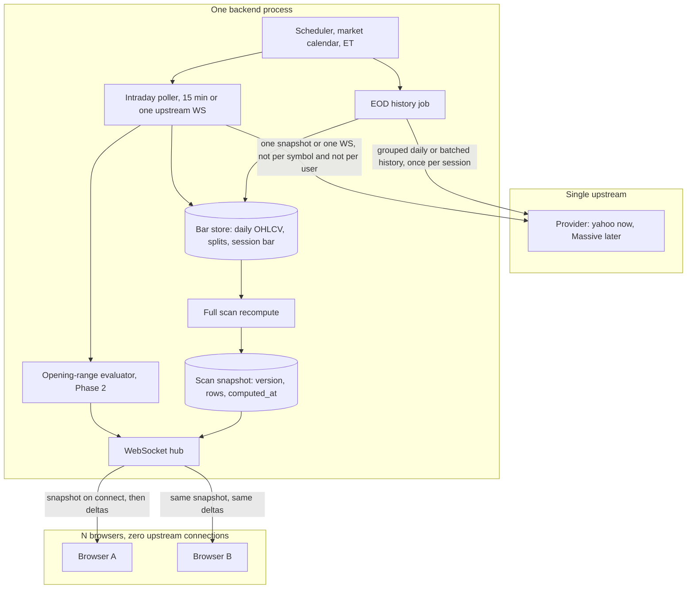

# TiltKiller data architecture plan

Planning only. Nothing in this document is implemented, and nothing is deployed. The app stays local-only until a later change.

Prices and terms below were read from vendor pages on **18 October 2026** unless a source says otherwise. Anything that did not come from a vendor page is marked **unverified**.

## Recommendation

Build one backend fetcher and fan its result out to every browser. Swap the upstream vendor with configuration. Do not buy a personal or free plan and then show that vendor's prices to other people.

| Stage | Who sees the app | Data budget | Use | What they see | License |
| --- | --- | --- | --- | --- | --- |
| 1. Owner | You only | $0 | Yahoo via `yfinance`, one background fetcher | Full UI: prices, candles, scores | Personal. Local only. |
| 2. Friends | A few friends | $0 until a vendor says otherwise | Same fetcher | **Derived results only** (ranks, scores, leader status, setup labels). No prices, no candles. | Still redistribution. Do not turn this on until Massive (or another vendor) confirms it in writing. |
| 3. Founder subscribers | A few paying users | Same gate as friends | Same fetcher | Derived results only, plus in-app and email alerts that do not contain a price | Paying them does not create a license. Same written confirmation, or Stocks Business. |
| 4. A few hundred users | The product | **$2,499/month** list | Massive Stocks Business | Full UI, including prices and charts, on the licensed feed | Display / redistribution. Startup discount is negotiated and still not a $200 plan. |
| Owner alerts | You only | **$199/month** | Massive Stocks Advanced | Real-time prints for opening-range alerts | Personal, non-professional. You confirmed you qualify. Does not cover friends. |

Phase 2's $60 cap still buys Massive Stocks Starter at $29/month: 15-minute delayed data, five years of history, one snapshot call. It does **not** buy alerts. Starter and Developer are both 15-minute delayed. The cheapest Massive tier at or under a 5-minute delay is Stocks Advanced, real-time, and it sits in the Phase 3 budget, not the $60 budget. There is no 5-minute tier.

Friends, founder subscribers, and later users share one upstream fetcher. They never open their own vendor connection.

Massive is still the provider to build against. The personal tiers are cheap, the Business tier is the self-serve redistribution product, the API shape (grouped daily bars, one-call snapshot, WebSocket aggregates, flat files, splits) matches this scanner, and they ship an MCP server at `https://mcp.massive.com` plus official Python and JavaScript SDKs. A later agent can talk to the same vendor the scanner uses.

## Licensing conclusion

US equity prices are exchange data. The exchange, not the API wrapper, decides who may see them. A personal or non-professional subscription almost always means **one natural person, their own screen**. A second user of this app is redistribution, whether or not they pay you.

What the current UI shows is market data, not a private score:

- last price, day change, and dollar P/L
- daily, weekly, and monthly OHLC charts
- 1M / 3M / 6M percent returns
- trigger prices

Publishing those to anyone else is display of the underlying prices. A rank or a Strat label is closer to a derived signal. Vendors still treat a chart, a rebased price path, or a return that can be turned back into a price as the data itself. [Tiingo's terms](https://app.tiingo.com/tos/), updated 6 October 2026, say a single-name series rebased to 100 is not an allowed derived product, because one public price rebuilds the series. The same terms say rankings and scores are allowed only when they cannot be reversed into the price. Massive's [redistribution article](https://massive.com/knowledge-base/article/how-can-i-redistribute-massives-market-data) puts derived signals in between and says it is a conversation, not a rule you can apply yourself.

### Rollout, and what each stage is allowed to do

You are a non-professional under exchange rules and under Massive's rules, so Stocks Starter, Developer, and Advanced are plans you can buy for yourself. That classification does not extend to anyone else.

**Stage 1, you only, Yahoo.** Allowed: you, on your machine, researching and backtesting. The [yfinance readme](https://github.com/ranaroussi/yfinance) says the library is unofficial and that Yahoo's finance API is for personal use. Not allowed: a friend opening the same app, a hosted login, or republishing the cache.

**Stage 2, a few friends.** This is the first stage that is redistribution. "A few" and "they are not paying" do not matter. Massive's terms say you may not build an application for end users other than you, and Yahoo's personal-use line is the same shape. Friends may see the derived-results view below only after a vendor confirms that view in writing. Until that letter exists, friends do not get a login. Breadth widgets (StockCharts, CNN, WSJ) stay on your screen only.

**Stage 3, a few paying founder subscribers.** Payment does not license the underlying prices. The same derived-results gate applies. In-app and email alerts to these people are also redistribution if the alert carries a price, a candle, or an exact return. Alerts to them stay in the derived vocabulary ("NVDA, leader, opening-range break") until the license says otherwise.

**Stage 4, a few hundred users.** Plan on Massive Stocks Business at the published **$2,499/month**, not on an individual key with more viewers. A few hundred is still under the "200+ users" line Massive uses as an example of who needs Business, and it is already over it. Ask for the startup discount. The base plan is proprietary fair-market-value, which is what you show. Official NBBO is the Full Market add-on at $1,999/month plus exchange per-user fees.

**Your own real-time alerts** can run on Stocks Advanced while friends are still on a derived view, because that feed is licensed to you. Do not fan the real-time prices out. The alert evaluator runs once, then the fan-out strips prices for every connection that is not you.

### Derived-results presentation

Non-owner clients get a second projection of the same snapshot. The server computes it. The browser does not receive the owner payload and hide fields, because a hidden price in the JSON is still redistribution.

| Field | Owner | Friend or subscriber, until a display license |
| --- | --- | --- |
| Rank, score (0–100), leader / warning / broken | Show | Show |
| Setup label ("Inside week", "Weekly hammer", "No setup / leader") | Show | Show, without the trigger price |
| RS percentile bucket | Exact percentile | Coarse bucket: top 1%, top 5%, top 10%, below. An exact 1M/3M/6M return is omitted. |
| Theme name, rank inside the theme | Show | Show |
| Distance to trigger | Exact price and percent | Three words only: triggered, close, far. No percent, because a percent plus a public prior close rebuilds a price. |
| Last price, day change, dollar P/L, entry price | Show | Omit |
| OHLC charts, volume, weekly/monthly candles | Show | Omit. A rebased line is omitted too: one public price rebuilds it. |
| Earnings date | Show (Yahoo, for now) | Omit until that source is licensed for other people |
| Breadth: $NASI, Fear & Greed, advancers | Show | Omit |
| Opening-range alert | Symbol, range, price, time | Symbol, "opening-range break", time. No range high and no price. |

What still needs a written yes from the vendor, even in this stripped view: scores, ranks, setup labels, RS buckets, and the word "opening-range break". Massive says a derived signal may or may not be redistribution depending on how much price it reveals, and that the answer is a conversation. Tiingo allows rankings only when they cannot be reversed into the data, and will not grant an exception on a Power plan. Do not treat this table as clearance.

### Draft email to Massive

Do not send this from the repo. Copy it when you are ready.

```text
To: sales@massive.com
Subject: Non-professional — can derived scanner results be shown to a few users?

Hello,

I am a non-professional individual subscriber (not registered, not an adviser,
not employed by a bank in a registered role). I am building a personal US
equity scanner for about 650 symbols, growing to about 1,500. One backend
would fetch data once and fan results out to browsers. I would not give each
user their own API key or upstream connection.

I want to know which of these, if any, an individual Stocks plan allows:

1. Only I see prices, OHLC charts, and exact returns. A few friends, and later
   a few paying subscribers, see derived results only: a 0–100 score, rank,
   leader / warning / broken, a setup name (for example "Inside week") with
   no trigger price, a coarse relative-strength bucket (top 1% / 5% / 10%),
   and an alert that says a symbol had an opening-range break with no price
   and no range. No last price, no candles, no exact percent returns.

2. If (1) is not allowed on Starter, Developer, or Advanced, what is the
   cheapest plan that permits that derived view for fewer than ten users,
   and then for a few hundred users?

3. If those users must see last price and candlestick charts, please confirm
   that Stocks Business at the current list price is the correct license, and
   whether the startup discount applies. I do not need the exchange NBBO
   add-on if fair-market-value is enough for display.

I am not asking you to enable redistribution on an individual key. I am asking
which published plan matches this product before I show it to anyone else.

Thank you
```

**Multi-user product.** Compliant path:

1. Keep the single upstream connection. That part of the design is what vendors want: they license you, and you account for the people who see the data. One connection per browser is both a rate-limit problem and an extra unlicensed hop.
2. Sign a redistribution / display license before any other person can open the app.
3. Prefer a feed sold for display without per-user exchange paperwork. Massive Stocks Business is that product: proprietary fair-market-value (FMV) intraday, full SIP end-of-day, "no exchange fees or approvals" on the base plan ([business stocks page](https://massive.com/business-stocks)). List price on [massive.com/stocks](https://massive.com/stocks): **$2,499/month**. Qualifying startups can get 25% or more off the first year; pre-launch companies get the larger cut. Email `sales@massive.com`. That discount, if granted, is still on the order of $1,900/month, not $200.
4. If the product must show the official consolidated tape (NBBO, SIP last sale) rather than FMV, add an exchange feed. Full Market real-time is **$1,999/month** on top, Full Market 15-minute delayed is **$499/month**, and exchange display fees are extra. Those fees are often per professional and per non-professional user. Do not assume the $2,499 base includes them.
5. Derived-only sharing (ranks, setup names, leader / warning / broken, no prices, no OHLC, no recoverable returns) is the only design that might stay on a cheaper license. Get it in writing. Do not launch on a theory. Tiingo will not grant that exception on Power; only a Start-up, Enterprise, or Institutional account can, and [those accounts start at $250/month](https://app.tiingo.com/tos/) (terms, 6 October 2026). That $250 is the floor to ask, not a quote for this UI.

Breadth widgets are a separate problem. `$NASI` is scraped from StockCharts, Fear & Greed from CNN, advancers/decliners from the WSJ diary (`backend/strat/breadth.py`). Those pages are not a data license. Fine on your own machine. Drop them, or replace them with a licensed source, before other users see them.

## Current-state audit

### What the scanner needs from the data

The score is a pure function of daily OHLC and volume (`backend/strat/leadership.py`, `backend/strat/scanner.py`):

- 1M / 3M / 6M percent price returns versus QQQ, so a name needs a little more than six months of daily bars before it can be a leader
- 10 / 20 / 50-day averages and a 5-bar slope
- 52-week and 6-month highs (252 and 126 sessions; measures are skipped under 60 bars)
- 20-day average dollar volume and range, 14-day ATR
- weekly and monthly candles resampled from daily bars, including the still-forming period
- charts: up to 60 monthly, 156 weekly, and 260 daily candles

Three years of daily bars (`STRAT_HISTORY_PERIOD=3y`) covers the live scanner and the current backtest. The backtest's first cut-off is 2024-05-10, which needs six months of history behind it (`RANK_START` in `backend/strat/backtest.py`).

### Source and library

One price source: **Yahoo Finance through `yfinance` 1.7.0** (`backend/requirements.txt`). No API key. Calls live in `backend/strat/data.py`:

- universe refresh: `yf.download(..., interval="1d", auto_adjust=False, actions=False, threads=True)`, batched
- one-off ticker lookup (watchlist / positions): `Ticker.history` with the same flags
- industry and earnings: `Ticker.info`, `Ticker.calendar`, `Ticker.get_earnings_dates`

`auto_adjust=False` and `actions=False` mean the cache stores **raw, unadjusted OHLC**. Splits and dividends are not applied and are not stored. A split looks like a crash in relative strength, moving averages, and the backtest. This is the main data-quality gap in the current pipeline.

Other sources, not used for prices:

| Source | Used for | Where |
| --- | --- | --- |
| Wikipedia | Current S&P 500 and Nasdaq-100 membership | `backend/strat/universe.py` |
| StockCharts, CNN, WSJ | Breadth widgets, 10-minute in-process cache | `backend/strat/breadth.py` |
| `backend/data/themes.yaml` | Curated themes | `backend/strat/themes.py` |

### Universe

`backend/data/universe.csv` has **646 symbols** as of this audit:

| Slice | Count |
| --- | --- |
| Stocks | 619 |
| S&P 500 (including names also in the Nasdaq-100) | 503 |
| Nasdaq-100 (including names also in the S&P 500) | 101 |
| Theme-only additions (`indexes=THEME`) | 101 |
| ETFs (11 sector SPDRs + 13 industry + QQQ, SPY, IWM) | 27 |

The README's "~550 symbols" is the pre-theme figure. Watchlist and position tickers outside this file are added to the effective universe and refreshed with it (`backend/strat/members.py`).

Membership is **today's** Wikipedia list plus the current theme file. Names that left the indexes are absent. The backtest docstring states that survivorship bias directly.

### How history is fetched and cached

SQLite at `backend/data/cache.sqlite3` (`STRAT_CACHE_DB`). One table, `bars`, keyed by `(symbol, date)`, holds open, high, low, close, volume. The same file holds watchlist, positions, extra symbols, earnings, and a `meta` row `last_refresh`.

`data.refresh`:

- new symbols, or `--full`: `3y` of daily bars
- symbols already cached: `3mo` (`STRAT_INCREMENTAL_PERIOD`)
- batches of 80 (`STRAT_DOWNLOAD_BATCH`)
- three attempts, sleeping 2s, 4s, then 6s
- `INSERT OR REPLACE` per bar

`load_daily` / `load_all_daily` hide every bar after `STRAT_AS_OF` when that variable is set. The cut-off is a read filter. The cache itself is not trimmed. Weekly and monthly candles are resampled in memory (`W-FRI`, calendar month). The last candle is the unfinished period.

There is no intraday table, no quote table, and no corporate-actions table.

### How Refresh works

The UI polls `GET /api/status` every 15 seconds, or every 1.5 seconds while a refresh is running (`web/src/App.tsx`). **↻ Refresh data** calls `POST /api/refresh`, which starts one daemon thread if one is not already running (`backend/strat/api.py`):

1. Incremental (or full) Yahoo download for the effective universe.
2. Industry backfill.
3. Earnings for every symbol (`max_age_hours=0`), 8 threads, one or two Yahoo calls each (`backend/strat/earnings.py`).
4. Full `scan_all` into an in-process `State`.

Startup starts a full download when the cache is empty, otherwise a background earnings refresh for entries older than 12 hours. The CLI `npm run refresh` does the same download plus earnings, without the scan. Nothing polls on a timer. Data is as fresh as the last click.

The README says the first download of about 550 symbols and 3 years of bars takes about a minute. This audit did not re-time it. An incremental pass is about 9 batched Yahoo calls for 646 symbols, plus the earnings fan-out, which is the part that actually looks like hundreds of requests. Yahoo publishes no rate limit for this unofficial API. The yfinance issue tracker says the limit is whatever Yahoo treats as a bot; bursts have produced temporary 404s. The retry loop is the only protection.

### What the backtest needs

`npm run backtest:leaders` (`backend/strat/backtest.py`) does not call Yahoo. It reads the SQLite cache, and for every other Friday from 2024-05-10 it drops bars after that date and runs the scanner. It then looks forward 1 month and 3 months inside the same cache. Requirements:

- daily bars from roughly November 2023 through at least 3 months after the last cut-off you care about
- the same price definition at every date (today: raw closes, so a split inside the window corrupts both the score and the forward return)
- QQQ in the cache
- today's universe, not the universe as it was on the cut-off date

`STRAT_AS_OF` is the same cut, applied to the live API instead of the backtest loop. Both must keep working after the fetcher moves to the background.

## Target architecture

One process owns the upstream connection. Browsers never call Yahoo, Massive, or anyone else. They receive a snapshot when they connect, then deltas.



### Jobs

All of these run inside the existing FastAPI process. A separate worker process is unnecessary at 650 symbols. `State.refreshing` and the refresh thread go away; a scheduler takes their place.

**End-of-day history job.** Once per trading day, after the close plus the plan's delay (about 16:20 ET on a 15-minute delay, and again if the vendor revises). Upsert official daily bars for the universe. New symbols get the full history window. Known symbols get the recent window only. Then a full scan, then a new snapshot version.

**Intraday poller.** Every 15 minutes from 9:30 to 16:00 ET on a trading day, and once at the open. Updates **today's unfinished daily bar** only (open stays at the open, high/low expand, close and volume move). Does not re-download three months. Rebuilds the forming weekly and monthly candles from that bar, reruns `scan_all`, and publishes a delta. Outside regular hours the poller sleeps. Phase 3 replaces the timer with one upstream WebSocket of minute aggregates or last trade, still a single connection, and coalesces updates (for example once a second, or on a meaningful price change) so 650 names do not flush the browsers on every print.

**Scan recompute.** A full scan is the right default. Percentile ranks, theme indexes, and leader status all depend on the cross-section, so patching one symbol is how ranks drift. 650 names is a small scan; the backtest's cost comes from repeating it across dozens of dates, not from one pass. If a later profile says a pass is too slow for the poll interval, the optimization is to recompute only symbols whose session bar changed and then rebuild the percentile tables once, not to skip the cross-section.

**Startup.** Serve the last persisted snapshot immediately, even if today's poll has not finished. If the newest daily bar is behind the last completed session, run the EOD job before trusting the snapshot. An empty database still means a full backfill, but the UI shows "loading history" from the snapshot channel rather than a button.

**Universe maintenance.** Stays a deliberate command (`npm run refresh:universe`, `npm run themes:sync`), not a 15-minute job. Wikipedia and the theme file change rarely. New theme tickers get a one-symbol backfill when they are added.

### Incremental versus full

| Event | What is downloaded | What is recomputed |
| --- | --- | --- |
| Process start, cache warm, last session present | Nothing, until the next poll | Nothing; serve the stored snapshot |
| Process start, cache empty | Full history window | Full scan after the backfill |
| New symbol | Full history window for that symbol | Full scan |
| Every 15 minutes, session open | Today's bar for the universe, one vendor call when the vendor allows it | Full scan; clients get deltas |
| After the close | Official daily bar, one date | Full scan; snapshot version bumps |
| Manual "full" | Kept as an operator command, not a button | Full scan |

`STRAT_AS_OF` disables the intraday poller and the EOD job's write past that date. Reads keep the existing `date <= AS_OF` filter. The WebSocket snapshot is the cut-off scan, and the status line stays "cut-off view, data through …".

## Storage and cache

Stay on **SQLite** for the single-node design. The file is already the system of record, writes are serialized by `_write_lock`, and 646 symbols times ~750 sessions times a few numbers is a few tens of megabytes. Postgres is the step when a second API instance needs the same bars. Redis is the step when a second instance needs the same pub/sub. Neither is required to make one process serve many browsers. Parquet is an export for offline research, not the live store; Massive flat files land there later if a long backtest should not hit the API.

Add, do not replace, the current tables:

| Store | Contents | Who reads it |
| --- | --- | --- |
| `bars` | Completed daily OHLCV, unadjusted, one row per symbol per session | Scanner, charts, backtest |
| `corporate_actions` | Split ratio and ex-date; dividend amount later if total return is wanted | Adjustment at read time |
| `session_bar` | The unfinished bar for today, overwritten by the poller | Live scan only. Never written into `bars` until the EOD job confirms the session. |
| `scan_snapshot` | JSON of the scan payload, monotonic version, `computed_at`, provider, delay | HTTP first paint and WebSocket connect |
| `alerts` | Opening-range events for the session | Reconnect catch-up, Phase 2 |

In-process memory keeps the current `State.scan` so a poll does not reread the snapshot it just wrote. The persisted snapshot is what a restart and a new browser use, so the first paint does not wait on Yahoo.

Client cache: the browser holds the last snapshot in memory and applies deltas. A `sessionStorage` copy of that snapshot gives an instant table on reload, replaced when the HTTP or WebSocket snapshot version is newer. Do not put the price cache in `localStorage` with no expiry; a stale price shown as live is worse than a spinner.

## WebSocket server

FastAPI already serves the API. Add one route, `/ws`, on that same process. `uvicorn[standard]` brings the WebSocket stack. Browsers keep using the Vite dev proxy locally; a later host terminates TLS and proxies `/ws` with upgrade support.

**On connect.** Send one `snapshot` message: version, `computed_at`, provider, `delay_seconds`, `as_of` (null unless `STRAT_AS_OF` is set), scan rows, and the small market/theme summaries the current pages need. If the client passes `?since=<version>` and that version is still the current one, skip the body and send `snapshot_unchanged`. If the server has restarted and the version is unknown, send the full snapshot. Never depend on the client to have cached history the server cannot resend.

**Deltas.** After each poll, send `delta` with the new version and only the symbols whose displayed fields changed (price, change, day high/low, score, rank, leader status, trigger). A full snapshot still goes out when the version gap is large or the universe membership changed.

**Heartbeats.** Server sends `ping` every 15 seconds. The client answers `pong`. If the client misses two intervals it reconnects with the last version. The status line goes "reconnecting" immediately, and "stale" if `computed_at` is older than two poll intervals during market hours.

**Backpressure.** One snapshot in memory. A slow client is disconnected rather than queued without bound; it reconnects and gets a fresh snapshot. There is no per-user upstream subscription list. Watchlist alerts are a filter on the way out, applied to the shared event.

**HTTP stays.** `GET /api/scan`, `/api/market`, `/api/themes`, and `/api/symbol/{symbol}` read the same snapshot and bar store. First paint can be HTTP, with the socket delivering everything after. `POST /api/refresh` is removed. `GET /api/status` remains for the indicator: last success, next poll, delay, error, symbol counts. It is no longer a progress ticker for a button.

## Frontend

- Remove **↻ Refresh data**, `RefreshBanner`, and the 1.5-second refresh poll (`web/src/App.tsx`, `web/src/components/Loading.tsx`, `api.refresh`).
- Replace the header text with a live indicator: a dot for connected / reconnecting / stale, the delay ("15-min delayed" or "real-time"), and the snapshot time in ET ("updated 15:45 ET"). The cut-off sentence stays when `STRAT_AS_OF` is set.
- Pages that already refetch when `dataVersion` changes keep that mechanism. `dataVersion` becomes the snapshot version, bumped by the socket, not by the end of a manual refresh.
- Watchlist and Positions empty-state copy that says "after the next refresh" becomes "waiting for the first download" and only shows when the symbol is absent from the bar store.
- Footer attribution follows the provider. Yahoo's unofficial status stays visible while Yahoo is the provider.
- No refresh affordance, including on the detail page. Adding a symbol still validates and backfills that one symbol on the server; the socket then includes it.

## Backtest data strategy

The backtest keeps reading the local bar store. It does not open a vendor connection and it does not see the session-bar overlay, so a half-finished today cannot leak into a historical cut-off.

**Point in time.** Keep `STRAT_AS_OF` and `cut_off()` as a date slice on unadjusted bars, then apply corporate actions whose ex-date is on or before that slice. A split that happens next month must not rewrite the prices the scanner saw last month. Massive's own docs warn that their default `adjusted=true` **does** rewrite history when a later split happens. Store unadjusted bars (`adjusted=false` on Massive, which is what Yahoo is already doing) plus the split table, and adjust at read time.

**What "adjusted" should mean.** Split-adjust for anything that computes a return, a moving average, or a chart. Dividend adjustment (total return) is a second series. The current score uses price return, not total return. Changing that would move the backtest numbers. Do not switch to total return as part of the plumbing. Do start split-adjusting; an unadjusted split is a bug, not a choice.

**Survivorship.** The backtest remains biased toward names that are in the S&P 500, Nasdaq-100, or theme file today. Massive keeps delisted tickers and tick history back to 2003 on Advanced and Business, which removes one hole (a dead ticker's prices) and leaves the larger one (historical index membership). Wikipedia will not provide that. A point-in-time constituent list is a separate dataset and is not in the $0–$200 plans verified here. Keep the bias note in the backtest output. Weight tuning on the current cache is still useful; it is not a claim about a tradeable, unbiased edge.

**Depth.** Three years is enough for the live score and for `RANK_START`. Five years (Massive Starter) gives the backtest more regimes. Ten years (Developer, $79, over the Phase 2 cap) or the full archive (Advanced) is how you would lengthen it later. Forward 1M and 3M returns still require bars **after** the cut-off, so the cache has to extend past the test window. The EOD job is what grows that window from now on.

**Reproducibility.** Record `provider`, `adjustment` (`split` or `none`), and the universe file hash on each backtest run. A provider swap should be a deliberate re-run, not a silent change in the closes.

## Provider abstraction

One protocol, two implementations. Callers in `refresh`, the scheduler, and the lookup path stop importing `yfinance`.

```text
MarketDataProvider
  fetch_daily(symbols, start, end) -> unadjusted daily bars
  fetch_session(symbols) -> today's unfinished bar
  fetch_actions(symbols, start, end) -> splits (and dividends if the vendor has them)
  stream_session(symbols) -> optional; Phase 3 only
```

Configuration:

| Variable | Phase 1 | Phase 2 | Phase 3 |
| --- | --- | --- | --- |
| `STRAT_DATA_PROVIDER` | `yahoo` | `massive` | `massive` |
| `STRAT_DATA_DELAY` | `15m` | `15m` | `realtime` |
| `STRAT_POLL_SECONDS` | `900` | `900` | `0` (upstream socket; coalesce) |
| `MASSIVE_API_KEY` | unset | set | set |

`yahoo` implements `fetch_session` as a short-window daily download and treats the last bar as unofficial and possibly delayed. `massive` implements `fetch_daily` with the grouped daily endpoint for a date, or per-ticker ranges for a backfill, and `fetch_session` with one full-market snapshot filtered to the universe. The scan, the snapshot, and the socket do not change.

Earnings stay behind their own small interface. They are not on the price poll. Massive financials are a separate $29 individual add-on and a $699 business add-on ([massive.com/stocks](https://massive.com/stocks)); Benzinga news is $99 per dataset. Do not bundle earnings into the price vendor until those are worth paying for. Phase 1 can keep Yahoo for earnings while the price path is already abstracted.

## Provider comparison

Cadence below is what you can honestly show. "Real-time" on a personal plan still cannot be shown to customers.

| Provider | Price checked | What you get inside the budget | 650 names at 15 min | Multi-user prices and charts |
| --- | --- | --- | --- | --- |
| Yahoo via yfinance | $0 | Unofficial daily bars, no SLA, raw OHLC. Good enough for the current backtest if splits are handled later. | About 9 batch calls per poll. No published limit; throttling is real. | Not allowed. Personal use, and the library says so. |
| Massive Basic | $0 | End-of-day, 2 years of bars, **5 requests/minute**. No snapshot, no WebSocket. | One grouped-daily call after the close fits. Intraday does not. | Not allowed. Individual plan. |
| **Massive Starter** | **$29/month** | 15-minute delayed aggregates, 5 years, unlimited REST on a paid stocks plan, snapshot, WebSocket, flat files, second aggregates, MCP. No trades or quotes. | One snapshot per poll. | Not allowed. |
| Massive Developer | $79/month | Same delay as Starter, 10 years of bars, trades included, still no quotes. | Same as Starter. | Not allowed. Over the $60 cap. |
| **Massive Advanced** | **$199/month** | Real-time, full history back to 2003, quotes, non-professional only. | One upstream WebSocket. | Not allowed. |
| **Massive Stocks Business** | **$2,499/month** | Commercial FMV intraday, SIP end-of-day, 20+ years, display rights. Startup discount is negotiated. | Same API shape. | **This is the compliant product license.** Exchange NBBO is extra. |
| Alpaca Basic | $0 with a brokerage account | Real-time **IEX only** (a few percent of US volume). Historical SIP withheld for the latest 15 minutes. WebSocket cap **30 symbols**. 200 REST calls/minute. | Per-symbol polling fits the REST cap and misses most prints. Cannot stream 650 names. | Not allowed. [Alpaca staff, 3 Sep 2026](https://forum.alpaca.markets/t/use-sip-data-feed-for-display/19641): data and derivations cannot be given to third parties; a scanner others can access is out. Commercial licensing was described as maybe six months out. Unconfirmed until a contract exists. |
| Alpaca Algo Trader Plus | $99/month | Full SIP, unlimited WebSocket symbols, 10,000 calls/minute, history since 2016. | Technically comfortable. | Same personal-use terms. Over the $60 cap. |
| Tiingo Power | $30/month or $300/year | Individual, internal use. 30+ years EOD, IEX real-time, 10,000 requests/hour, 100,000/day. Free tier is 500 symbols/month and forbids persistent storage. | REST budget is fine. IEX is not the consolidated tape, so leaders printing on Nasdaq or NYSE look wrong intraday. | Not on this plan. API data is internal only. Start-up / Enterprise / Institutional exceptions **start at $250/month** and still need written approval. |
| Tiingo Commercial | $50/month or $499/year | Internal use for a business, higher caps. The pricing page says you still may not display or share data with another person or organization. | Same tape limitation. | Not included. |
| EODHD personal | Free 20 calls/day; EOD $19.99; EOD+Intraday **$29.99**; All-in-One $99.99 | Personal only ([commercial-vs-personal](https://eodhd.com/financial-apis/commercial-vs-personal-license-use)). Delayed live is 15–20 minutes. Intraday history is included on the $29.99 plan. WebSocket real-time is capped at **50 tickers**. 100,000 calls/day, 1,000/minute. | REST polling fits. Streaming the universe does not. | Personal plans are not commercial. Internal-use commercial is $399/month; Enterprise is $2,499/month on [the commercial page](https://eodhd.com/commercial-pricing). Internal use is not the same as showing data to your users. |
| Financial Modeling Prep | Starter $29, Premium $69, Ultimate $139 per month | Personal. Display or redistribution needs a separate agreement. Commercial prices are not published. | Call limits on Starter (300/minute on the pricing page) can poll 650 names inside 15 minutes. | Not on these plans. [Terms](https://site.financialmodelingprep.com/developer/docs/terms-of-service) forbid sharing data or hosting it for others. |
| Databento | US Equities Standard **$4,000/month** from 22 June 2026 ([blog](https://databento.com/blog/updates-to-subscription-pricing)) | Excellent tick data. Standard is personal / non-display. External distribution is a Plus feature. | Overkill and over budget. | A [Databento staff reply on 14 Mar 2026](https://www.reddit.com/r/Databento/comments/1rt8uc2/display_use_to_end_user_product/) said $1,500/month is the minimum for a SaaS displaying real-time data, or $14,400 prepaid for a year. That reply is not a current price page. US Equities Mini is the feed they describe as displayable without per-user exchange fees; confirm the live quote before relying on it. |
| Interactive Brokers | Delayed streaming: $0. US Securities Snapshot bundle: $10 non-pro (waived with activity) plus $0.01 per snapshot. US Equity and Options streaming add-on: $4.50 non-pro. | You already have the account. Delayed streaming exists (`reqMarketDataType(3)`, about 15 minutes). Historical requests need a live market-data subscription and are paced at **60 requests per 10 minutes**. | A full historical pass of 650 symbols takes about two hours of pacing. The API is a trader's gateway, not a 650-name server feed, and it requires TWS or Gateway to stay logged in. | Subscriber agreement: no right to redistribute. Leave IBKR as the brokerage. Do not make it the scanner's upstream. |

Massive wins the comparison on three facts that survive the license wall: one call can cover the whole US market, the personal price is inside both budgets, and the business tier is a published product instead of "email us and hope." Tiingo is the cheapest *named* door into a possible written exception ($250 floor), and it is still IEX for the live print, with charts and rebased series called out as not allowed unless that exception is granted. Alpaca's $99 SIP plan is the best raw tape under $200 and is explicitly unavailable for this product.

## Per-phase plan

### Phase 1 — free, 15-minute, you only

- Provider: `yahoo`.
- Cost: $0 data. Hosting is a separate question and is not decided here.
- Cadence: 15-minute session poll and one EOD job. Treat Yahoo's last daily bar as delayed and unofficial. Do not promise a clock time tighter than the poll.
- License: your personal research, including the backtest. The moment a second person can open the UI and see a price or a candle, stop.
- Why not Massive Basic: five calls a minute and end-of-day only is a worse live experience than what you have, and it is still individual-only.
- Why keep Yahoo for now: the cache, the tests, and `STRAT_AS_OF` already work, and a provider interface lets you delete the Yahoo calls later without rewriting the scan.

### Phase 2 — $29, you only, 15-minute data, no timely alerts

- Provider: Massive Stocks Starter, **$29/month**, read from [massive.com/stocks](https://massive.com/stocks) on 18 October 2026. Annual billing was not in the text extract; do not assume a discount.
- Cadence: 15-minute delayed. The page says Starter and Developer get 15-minute delayed data, and the per-second aggregate docs put Starter on `wss://delayed.massive.com`, not the real-time socket.
- What the $60 cap cannot buy: anything faster than 15 minutes. Developer is $79, still 15-minute delayed, and over the cap. Five years of history is enough (your decision). Developer’s ten years is unnecessary.
- Alerts: do not ship opening-range alerts on this tier. A 15-minute tape cannot meet a 5-minute trading decision.
- License: you only. Friends stay off until the email above is answered.
- Earnings stay on Yahoo for you. Breadth widgets stay on your screen.

### Alerts tier — real-time, $199, you only

Checked again on 18 October 2026. [massive.com/stocks](https://massive.com/stocks) says real-time exists on Advanced and on Business plans, and that Starter and Developer are 15-minute delayed. The aggregates docs repeat that: Basic is end-of-day, Starter and Developer are 15-minute delayed, Advanced is real-time. There is no plan whose delay is “under 5 minutes but not real-time.”

The Advanced **dollar** price did not survive the text extract of the plan cards on 18 October (Starter $29, Developer $79, and Business $2,499 did). Copies of the same pricing page dated 24 September 2026 and 3 October 2026 both list Stocks Advanced at **$199/month**. Treat $199 as the price to re-check on the card before buying, and treat “Advanced is the cheapest real-time individual tier” as verified from the vendor’s own page today.

That $199 is inside the Phase 3 cap and **outside** the $60 Phase 2 cap. It is a non-professional personal license, which matches your status. It lets the single fetcher see prints in real time so an opening-range alert can fire within the 5-minute bar you trade. It does not let friends see the price inside that alert.

### Phase 3 product — hundreds of users

- When other people can see prices and charts: Massive Stocks Business, list **$2,499/month** on the stocks page today.
- Your real-time personal alerts can start earlier, on Advanced, without waiting for Business.
- Do not add Full Market ($1,999) or Nasdaq Basic ($1,999) until FMV is not good enough for the prices you show.

### When there are other users

This does not fit Phase 3's budget. Budget a commercial conversation, not another personal API.

- Default ask: Massive Stocks Business at $2,499/month, FMV for the live last price and charts, SIP end-of-day for the official close the backtest should prefer. Ask for the startup discount in writing.
- If FMV is not acceptable for the prices you show, add Full Market Delayed ($499) or Full Market ($1,999) and the exchange's per-user display fees. Get those fees quoted for the expected non-professional user count before building billing.
- Alternative to price in the same conversation: Tiingo, starting at $250/month for an account that is allowed to request an exception. Only useful if they will license the actual UI, including candles. IEX-only live data is a weak tape for this scanner.
- Databento is the specialist tick vendor. Use it if you outgrow FMV and want a feed that is explicitly clearable for display. The numbers on record ($1,500 staff reply, $4,000 Standard) are both above $200.
- EODHD Enterprise ($2,499) and FMP's unpublished enterprise agreement are in the same band as Massive Business without Massive's FMV-without-exchange-fees packaging. No reason to prefer them on what is public.

## Opening-range alerts (Phase 2 design, useful in Phase 3)

One evaluator on the server, after each session update, for the shared universe. Users do not open their own vendor sockets.

**Definition.** The opening range is the high and low of the regular-session prints from 9:30 ET until 9:45 or 10:00 ET (configuration, default 15 minutes). Pre-market does not count. The range locks when that window ends. A long alert is a later print at or through the range high. This scanner is long-only, so a break of the range low is a status, not an alert, unless you later ask for it.

**Who can alert.** Default: symbols that are leaders on the latest snapshot, plus anything on your watchlist or in positions. Not all 650 names. The evaluator still sees the whole universe; the fan-out filter decides who is notified.

**Payload.** Symbol, range high, range low, price that crossed, timestamp of the vendor event, and how delayed that timestamp is. Store it in `alerts` so a reconnect during the same session receives today's alerts once.

**When it can be honest.** The range is the first 15 minutes. The alert may fire any time after that window closes. Every alert has to be real-time or under a 5-minute delay, because entries are taken from a 5-minute chart. Starter’s 15-minute tape misses that. Build the evaluator against the provider interface now if useful, and enable delivery only when the provider delay is at most 5 minutes (Advanced for you, Business if subscribers get the priced version).

**Delivery.** In-app over the existing WebSocket, and email. No Slack and no phone push. The point of the email is to bring the person back into the app, so the message is one line and a link, not a price table. Friends and subscribers get the derived sentence only. You get the price. No delivery path calls the data vendor.

## Rate-limit budget

Regular session is 6.5 hours, so a 15-minute poll is **26 passes per session**. Extended hours, 4:00–20:00 ET, would be about 64. Phase 1 and 2 should stay on the regular session.

| Design | Calls per pass | Calls per session | Against the limit |
| --- | --- | --- | --- |
| Naive, one HTTP call per symbol | 650 | 16,900 | Alpaca Basic: 200/minute, so one pass takes ~3.3 minutes and is legal but wasteful. EODHD paid: 1,000/minute and 100,000/day, so it fits. Tiingo Power: 10,000/hour, so it fits. Massive paid: unlimited, so it fits and is still the wrong shape. Yahoo: 650 unofficial calls, likely to throttle. IBKR historical: 60 per 10 minutes, so one pass is ~2 hours and cannot run every 15 minutes. |
| Current Yahoo batches of 80 | 9 | ~234 | Plausible for a manual refresh. Risky every 15 minutes all day, on top of earnings. No contract. |
| **Massive grouped daily (EOD) or full-market snapshot (intraday)** | **1** | **26, plus 1 EOD call** | Paid stocks plans have no REST cap. Free Basic is 5/minute, which still allows the EOD call and forbids a busy poller. |
| Massive or Alpaca Plus, one upstream WebSocket | 1 connection | n/a | The right Phase 3 shape. Alpaca Basic's 30-symbol cap cannot hold this universe. Massive Starter includes WebSockets; minute aggregates on Starter are 15 minutes delayed. |

Earnings must not share this budget. A full earnings sweep is hundreds of extra Yahoo calls. Run it on its own schedule (the current 12-hour freshness rule is enough) and never inside the 15-minute price poll.

## Risks

- **Shipping on a personal key.** The API will not refuse the call. Massive says exchanges audit redistribution, and the terms tell you to move to the right license before that happens. This is the risk that dominates the others.
- **Yahoo breaks.** Undocumented endpoints, no notice. The provider interface is what makes that a bad day instead of a rewrite.
- **Unadjusted splits.** Already true. A split in a held leader will scramble its score until corporate actions are stored.
- **Survivorship.** Already disclosed. Do not "fix" it by silently mixing a delisted-ticker dump into the current universe without membership dates.
- **Delayed alerts mistaken for live ones.** The status line has to say the delay in the same place as the alert time.
- **FMV versus SIP.** Business-plan live prices are Massive's calculated fair value unless you buy an exchange add-on. They can differ from the print on your brokerage. The EOD job should prefer the official daily bar for the backtest.
- **Breadth scrapers.** They will break, and they are the weakest licensing story in the app.
- **SQLite plus a poller.** The existing write lock is correct only if the poller, the EOD job, and request handlers keep using it. A second connection that writes around the lock will corrupt the file.
- **Snapshot size.** The full scan JSON is small at 650 rows. Theme and market chart payloads are larger; send those on the HTTP chart routes, and keep the socket to rows plus changed candles for symbols currently on screen only if profiling says the full chart set is too big. Start simple: rows on the socket, charts over HTTP from the same bar store.
- **Professional status.** You are a non-professional, so Starter and Advanced are available to you. Revisit this if that status changes. Business is still required before other people see prices.
- **Eco dyno sleep.** A sleeping dyno skips polls and drops WebSockets. The hosting section below is why the always-on Basic dyno is the one to use later. Nothing is deployed from this plan.

## Hosting later (Heroku, not deployed)

Nothing in this repository is deployed. When you do host it, Heroku is the target because you already run a bot there. Render is the fallback. Prices below are from [heroku.com/pricing](https://www.heroku.com/pricing) and the routing article, read 18 October 2026.

The process model stays one fetcher. On a single dyno that fetcher, the scan, and the WebSocket hub live in the web process. A second dyno is only for isolating the poller from web restarts.

| Piece | Choice | Monthly | Why |
| --- | --- | --- | --- |
| Web | 1 Basic dyno | $7 | Always on. Holds the API, the WebSocket hub, and (at first) the scheduler. 512 MB RAM is enough for ~650–1,500 daily histories. |
| Worker | None at first. Add 1 Basic later if deploys must not interrupt a poll. | $0, then $7 | The worker would be the only process that talks to the vendor. |
| Postgres | Essential-0 | $5 | 1 GB. The bar store is far smaller than that at 1,500 symbols and several years of daily bars. SQLite on a dyno disk disappears on restart and on deploy. |
| Redis | None at first | $0 | One process does not need pub/sub. Heroku Key-Value Store Mini is $3/month and 25 MB when a second web dyno must share the fan-out. |
| Eco dyno | Do not use | $5 for 1,000 shared hours | Sleeps after 30 minutes without HTTP traffic. A sleeping app misses the 15-minute poll, serves a stale snapshot on wake, and kills every WebSocket. Eco is also limited to personal accounts and two process types. |

**Total to leave running:** $12/month (Basic web + Essential-0 Postgres) before any market-data invoice. $19/month if you split a worker dyno. $22/month if you also add the $3 key-value store. That is hosting, not data.

**WebSockets.** Supported on every Heroku app ([routing](https://devcenter.heroku.com/articles/http-routing)). After the connection is up, each byte from either side resets a rolling **55-second** window. A quiet socket is closed with H15 or H28. The hub’s 15-second heartbeat exists for this, not only for the browser. The first response byte has to leave within **30 seconds** (H12). Send the snapshot immediately on connect; do not wait for a Yahoo poll.

**Scheduler.** An in-process loop on the always-on dyno. Heroku Scheduler runs a one-off dyno and then exits, so it is the wrong tool for a session that must poll every 15 minutes and keep sockets open. Do not scale the web formation above one dyno until the fetcher is pinned to a single worker. Two web dynos would be two upstream connections.

**Render fallback.** Use an always-on paid instance, not a free web service that sleeps. Put Postgres in Render’s managed database for the same reason as Essential-0. Confirm the instance price on Render’s page before choosing it over the $12 Heroku pair. The application shape does not change.

## Implementation steps

No step below is in scope for this pull request.

1. **Provider interface and Yahoo adapter.** Move `yf.download` and `lookup_symbol` behind `MarketDataProvider`. Behavior of the cache stays the same, including `auto_adjust=False`. Tests use a fake provider. This is the largest structural edit and it is confined to `data.py` plus a new module.
2. **Scheduler.** On startup, arm the EOD job and the 15-minute poller. Delete the refresh thread. Persist `session_bar` separately from confirmed daily bars so a crash mid-session cannot overwrite history with a partial bar.
3. **Persisted scan snapshot.** `scan_all` writes a versioned snapshot. HTTP handlers read it. Restart serves it before the first poll finishes.
4. **WebSocket hub.** Snapshot on connect, deltas, heartbeats, reconnect. One in-process subscriber list.
5. **Frontend.** Remove the button, the banner, and the fast status poll. Add the delay and freshness indicator. Drive `dataVersion` from the snapshot version.
6. **Corporate actions and split adjustment at read time.** Keep raw bars. Adjust only with ex-dates on or before the read date, including `STRAT_AS_OF` and the backtest. Re-run `npm run backtest:leaders` and expect the numbers to move where a split exists. That re-run is the test.
7. **Massive adapter, config-gated.** Grouped daily, one snapshot, splits. Ship it dark behind `STRAT_DATA_PROVIDER` until you add a key. No key in the repo.
8. **Opening-range evaluator.** After step 4, on the shared poll. In-app events only.
9. **Phase 3 stream.** Implement `stream_session` for Advanced. Coalesce. Leave the 15-minute poller as the fallback when the socket drops.
10. **Multi-user.** Only after a written redistribution license. Add auth and per-user watchlists on the fan-out. Do not add a second upstream connection.

Steps 1–6 are the Phase 1 product. Step 7 is the Phase 2 swap. Steps 8–9 follow the key you buy. Step 10 waits on licensing, not on code.

## Decisions recorded 18 October 2026

Answered:

1. Rollout is you, then a few friends, then a few paying founder subscribers, then a few hundred users. Friends are already redistribution. See the rollout section.
2. Other people need the scanner’s results (rank, score, leader status, setups). They do not need raw quotes. The derived-results view is the design. It still needs Massive’s written answer before anyone else logs in.
3. Host on Heroku later. Render is the fallback. See the hosting section. Do not deploy as part of this work.
4. Opening-range alerts start after the first 15 minutes, and each alert must be real-time or under a 5-minute delay. That rules out Starter. Advanced at about $199/month is the personal tier that qualifies.
5. Alerts go in-app and by email only, to bring people back into the app.
6. You are a non-professional. Starter and Advanced are plans you can hold yourself.

Defaults for the rest:

7. Five years of history is enough. Starter’s window covers it. Do not buy Developer for ten years.
8. The backtest uses split-adjusted prices. Adjustment is point-in-time: a split applies only on and after its ex-date, so `STRAT_AS_OF` and each backtest cut-off do not see a split that had not happened yet. Dividend (total-return) adjustment stays off.
9. Earnings dates stay on Yahoo for now, and only on your screen.
10. Breadth widgets stay owner-only until their sources are licensed.
11. The universe stays about 650 names, with headroom to about 1,500. One Massive snapshot still covers that. Yahoo batching gets tighter and should be replaced before the list gets much larger.
12. The acceptable Business-plan cost once there are paying users is still open. The list price is $2,499/month before exchange add-ons. The email above asks about the startup discount. Do not assume it lands near $200.

## Sources

Checked 18 October 2026 unless noted.

- Massive stocks overview (Starter $29 and Developer $79 are 15-minute delayed; Advanced and Business are real-time; Business list $2,499; Starter and Developer dollar prices and the delay sentence read 18 October 2026): https://massive.com/stocks
- Massive per-second aggregates, delayed vs real-time host, plan recency table: https://massive.com/docs/websocket/stocks/aggregates-per-second
- Advanced listed at $199/month on copies of the pricing page (24 September 2026 and 3 October 2026). The 18 October text extract dropped that dollar figure: https://www.itechguides.com/products/massive-formerly-polygon-io/pricing/ and https://stockmarketstack.com/tools/massive
- Heroku dyno, Postgres Essential-0 ($5), and Key-Value Store Mini ($3): https://www.heroku.com/pricing/
- Heroku routing, WebSockets, 30-second initial window, 55-second rolling idle window: https://devcenter.heroku.com/articles/http-routing
- Massive business stocks (FMV, no exchange fees on the base plan, startup discount, add-on prices): https://massive.com/business-stocks
- Massive redistribution explainer: https://massive.com/knowledge-base/article/how-can-i-redistribute-massives-market-data
- Massive market-data terms (personal use, no app for other end users): https://massive.com/legal/market-data-terms-of-service
- Massive professional vs non-professional: https://massive.com/knowledge-base/article/what-are-pro-and-non-pro-classifications-for-massives-stock-data
- Massive REST limits (paid tier unlimited, Basic 5/minute): https://massive.com/knowledge-base/article/what-is-the-request-limit-for-massives-restful-apis
- Massive grouped daily bars, and the warning that default split adjustment rewrites history: https://massive.com/knowledge-base/article/how-can-i-get-the-daily-prices-for-all-stocks-using-massives-market-data
- Massive history windows by plan: https://massive.com/knowledge-base/article/how-much-historical-stock-data-does-massive-have
- Massive MCP quickstart: https://massive.com/docs/ai-tools/quickstart
- yfinance personal-use notice: https://github.com/ranaroussi/yfinance
- Alpaca market-data plans (Basic vs Algo Trader Plus $99, IEX vs SIP, 30-symbol WebSocket, 200 calls/minute): https://docs.alpaca.markets/us/docs/about-market-data-api
- Alpaca personal-use terms: https://files.alpaca.markets/disclosures/library/TermsAndConditions.pdf
- Alpaca staff on scanners for other people, 3 September 2026: https://forum.alpaca.markets/t/use-sip-data-feed-for-display/19641
- Tiingo pricing ($0 / $30 individual / $50 commercial, internal use): https://www.tiingo.com/about/pricing
- Tiingo terms, last updated 6 October 2026 (derived-data rules, exception accounts start at $250/month): https://app.tiingo.com/tos/
- EODHD personal pricing: https://eodhd.com/pricing
- EODHD commercial vs personal: https://eodhd.com/financial-apis/commercial-vs-personal-license-use
- EODHD commercial prices ($399 internal, $2,499 enterprise): https://eodhd.com/commercial-pricing
- FMP pricing and the display-agreement notice: https://site.financialmodelingprep.com/pricing-plans
- FMP terms (personal use, no hosting for others): https://site.financialmodelingprep.com/developer/docs/terms-of-service
- Databento subscription pricing update, 29 May 2026, effective 22 June 2026, US Equities Standard $4,000: https://databento.com/blog/updates-to-subscription-pricing
- Databento staff on SaaS display minimum, 14 March 2026: https://www.reddit.com/r/Databento/comments/1rt8uc2/display_use_to_end_user_product/
- IBKR market-data pricing: https://www.interactivebrokers.com/en/pricing/market-data-pricing.php
- IBKR delayed data: https://www.interactivebrokers.com/docs/tws-api/doc/market-data-delayed/introduction.md
- IBKR historical pacing (60 requests / 10 minutes) and the live-subscription requirement for history: https://www.interactivebrokers.com/docs/tws-api/doc/md/introduction.md
